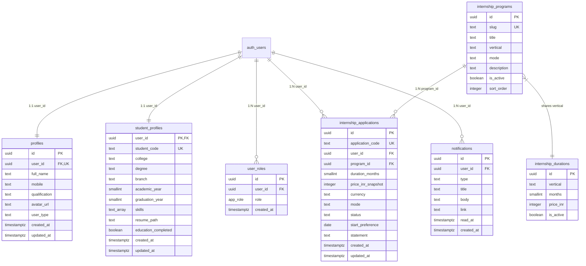

# Architecture Specification: Phase 1 — Student Authentication, Profile & Internship Applications

**Document Version:** 1.1.0 (Approved with Amendments)  
**Phase:** 1 (Auth, Profiles, Application Intake, Student Dashboard)  
**Target Repository:** `production-repo` (`AADHYRA-INNOVATIONS-PVT-LTD/career-launchpad-hub-62`)  
**Scope:** Student Identity, Role Integrity, Internship Programs & Application Flow (IT Online), Dashboard Consolidation.

---

## 1. Final Route Table

### 1.1 Public Pages (Unrestricted)
| Route Path | Component / Target | Description | Guard |
| :--- | :--- | :--- | :--- |
| `/` | `src/pages/Index.tsx` | Platform Landing Page | None |
| `/about` | `src/pages/AboutPage.tsx` | About Aadhyra Innovations | None |
| `/contact` | `src/pages/ContactPage.tsx` | Contact & Inquiries | None |
| `/services/*` | `src/pages/services/*` | IT & CRM Service Catalog Pages | None |
| `/internships` | `src/pages/InternshipPage.tsx` | Internship Catalog (IT cards link to `/internships/apply`) | None |
| `/placement` | `src/pages/PlacementPage.tsx` | Placement Overview | None |
| `/career` | `src/pages/JobPage.tsx` | Open Job Listings & Hiring | None |
| `/apply` | `src/pages/ApplyPage.tsx` | Legacy lead & application page (Navbar Apply Now stays linked here) | None |
| `/terms` | `src/pages/legal/TermsPage.tsx` | Terms & Conditions | None |
| `/privacy` | `src/pages/legal/PrivacyPage.tsx` | Privacy Policy | None |
| `/refund` | `src/pages/legal/RefundPage.tsx` | Refund Policy | None |
| `/cookies` | `src/pages/legal/CookiesPage.tsx` | Cookie Policy | None |
| `/disclaimer` | `src/pages/legal/DisclaimerPage.tsx`| Legal Disclaimer | None |
| `/verify` | `src/pages/CertificateVerifyPage.tsx`| Public Certificate Verification | None |

---

### 1.2 Auth Pages (PublicOnlyRoute: Redirects Logged-in Users to Role Dashboard)
| Route Path | Component / Target | Description | Guard |
| :--- | :--- | :--- | :--- |
| `/login` | `src/pages/auth/LoginPage.tsx` | Central Student Login (supports `returnTo` & legacy `redirect`) | `PublicOnlyRoute` |
| `/signup` | `src/pages/auth/SignupPage.tsx` | Student Registration (Name, Email, Mobile, Password, Terms checkbox) | `PublicOnlyRoute` |
| `/forgot-password` | `src/pages/ForgotPasswordPage.tsx` | Password Reset Email Request | `PublicOnlyRoute` |
| `/update-password` | `src/pages/UpdatePassword.tsx` | Password Update (Supabase Recovery Token) | Session / Recovery |
| `/verify-email` | `src/pages/auth/VerifyEmailPage.tsx` | Post-Signup "Check Inbox" & Resend Screen | Public |
| `/auth/callback` | `src/pages/auth/AuthCallback.tsx` | Email confirmation & OAuth PKCE token exchange | Public |

---

### 1.3 Legacy & Non-Student Auth Routes (Untouched)
| Route Path | Component / Target | Description | Notes |
| :--- | :--- | :--- | :--- |
| `/auth` | `src/pages/AuthPage.tsx` (Legacy) | Multi-tenant login for non-students | If role absent, "student", or "candidate" -> redirects to `/login`. Other roles (employer, freelancer, doctor, patient) render legacy UI. |
| `/admin/login` | `src/pages/admin/AdminAuth.tsx` | Admin Dedicated Login | Untouched; signs out non-admin immediately on login. |
| `/employer/auth` | `src/pages/employer/EmployerAuth.tsx` | Employer Dedicated Login | Untouched. |
| `/employer/register` | `src/pages/employer/EmployerRegister.tsx` | Employer Registration | Untouched. |

---

### 1.4 Student Protected Routes (`ProtectedRoute roles={['student', 'admin']}`)
| Route Path | Component / Target | Description |
| :--- | :--- | :--- |
| `/internships/apply` | `src/pages/InternshipApplyPage.tsx` | 1-Click Application Flow for IT Internships |
| `/dashboard` | `src/pages/dashboard/StudentOverview.tsx` | Student Dashboard Overview (Real DB stats, empty states) |
| `/dashboard/profile` | `src/pages/dashboard/DashboardProfile.tsx` | Student Profile (Personal, Education, Skills, Resume) |
| `/dashboard/applications` | `src/pages/dashboard/DashboardApplications.tsx` | Track Submitted Internship Applications & Codes |
| `/dashboard/internship` | `src/pages/dashboard/DashboardInternship.tsx` | Active Internship Deliverables & Tasks |
| `/dashboard/courses` | `src/pages/dashboard/DashboardCourses.tsx` | LMS Enrolled Courses (Legacy kept working) |
| `/dashboard/courses/:courseId/learn` | `src/pages/dashboard/CourseLearning.tsx` | LMS Video Player, Notes & Exam (Legacy) |
| `/dashboard/assignments` | `src/pages/dashboard/DashboardAssignments.tsx` | Task Submissions & Grades (Real tasks / empty state) |
| `/dashboard/payments` | `src/pages/dashboard/DashboardPayments.tsx` | Payment History (Untouched legacy logic) |
| `/dashboard/invoices` | `src/pages/dashboard/DashboardInvoices.tsx` | Invoices (Honest Phase 1 empty state) |
| `/dashboard/notifications` | `src/pages/dashboard/DashboardNotifications.tsx` | Notification Inbox & Read Markers |
| `/dashboard/certificates` | `src/pages/dashboard/DashboardCertificates.tsx` | Issued Certificates (Legacy kept working) |
| `/dashboard/experience-letters` | `src/pages/dashboard/DashboardExperienceLetters.tsx` | Experience Letters (Honest Phase 1 empty state) |
| `/dashboard/settings` | `src/pages/dashboard/DashboardSettings.tsx` | Password Change, Sign Out Everywhere |
| *Collapsible "More"* | `/dashboard/placement`, `/dashboard/interview`, `/dashboard/resume`, `/dashboard/portfolio`, `/dashboard/projects`, `/dashboard/progress`, `/dashboard/hr-tasks` | Legacy student tools grouped under collapsible sidebar section. |

---

### 1.5 Non-Student Protected Routes (NOT wrapped by new ProtectedRoute)
| Route Path | Component / Layout | Roles Allowed | Status |
| :--- | :--- | :--- | :--- |
| `/admin/*` | `DashboardLayout isAdmin` | `admin` | Wrapped with `ProtectedRoute roles={['admin']}` |
| `/employer/*` | `EmployerLayout` | `employer`, `admin` | Untouched legacy guard |
| `/freelancer-dashboard/*`| `DashboardLayout role="freelancer"` | `freelancer` | Untouched legacy guard |
| `/patient-dashboard/*` | `DashboardLayout role="patient"` | `patient` | Untouched legacy guard |
| `/doctor-dashboard/*` | `DashboardLayout role="doctor"` | `doctor` | Untouched legacy guard |

---

## 2. Database Schema (Phase 1)

---

### 2.1 Table Specifications & Security Amendments

#### 1. `public.student_profiles`
- `user_id`: `UUID PRIMARY KEY REFERENCES auth.users(id) ON DELETE CASCADE`
- `student_code`: `TEXT NOT NULL UNIQUE` (Generated via `generate_student_code()` in format `AAD-YYYY-NNNNNN`)
- `college`: `TEXT`
- `degree`: `TEXT`
- `branch`: `TEXT`
- `academic_year`: `SMALLINT CHECK (academic_year BETWEEN 1 AND 6)`
- `graduation_year`: `SMALLINT`
- `skills`: `TEXT[] DEFAULT '{}' CHECK (cardinality(skills) <= 30)`
- `resume_path`: `TEXT`
- `education_completed`: `BOOLEAN NOT NULL DEFAULT false`
- `created_at`: `TIMESTAMPTZ NOT NULL DEFAULT now()`
- `updated_at`: `TIMESTAMPTZ NOT NULL DEFAULT now()`
- **RLS Policies:**
  - `SELECT`: `auth.uid() = user_id OR public.is_admin()`
  - `UPDATE`: `auth.uid() = user_id` (USING and WITH CHECK)
  - `INSERT` / `DELETE`: Forbidden for regular clients.
- **Trigger Amendment (Amendment B.1):**
  A BEFORE UPDATE trigger blocks any change to `user_id` or `student_code` **ONLY when `auth.uid() IS NOT NULL AND NOT public.is_admin()`**. When `auth.uid() IS NULL` (service role, SQL editor, migrations, internal SECURITY DEFINER functions) the trigger allows the change.

#### 2. `public.profiles` Protection Trigger (Amendment B.2)
- A BEFORE UPDATE trigger on `public.profiles` raises an exception if `NEW.user_type IS DISTINCT FROM OLD.user_type` **when `auth.uid() IS NOT NULL AND NOT public.is_admin()`**. Non-admins are blocked from modifying `user_type`. Service role and SQL editor (`auth.uid() IS NULL`) or admins remain unblocked.

#### 3. `public.internship_programs` Seed (Amendment B.3)
- `description = NULL` for all programs (no invented marketing copy; UI handles null).
- Active programs (`is_active = true`):
  - `java-fullstack`: Java Full Stack Developer
  - `ai-ml`: AI & Machine Learning Engineer (maps to "Python & AI/ML Intern" card)
  - `data-analytics`: Data Analytics & BI Specialist
  - `aws-cloud`: Cloud Computing & DevOps (AWS)
- Inactive programs (`is_active = false`):
  - `python-fullstack`: Python Full Stack Developer
  - `data-science`: Data Science Specialist
  - `cyber-security`: Cyber Security Specialist

#### 4. `public.internship_durations` Seed (Amendment B.5)
- Vertical `'IT'` exact pricing:
  - 1 month: ₹4,999
  - 2 months: ₹9,999
  - 3 months: ₹14,999
  - 4 months: ₹19,999
  - 5 months: ₹24,999
  - 6 months: ₹24,999

#### 5. `public.internship_applications` & Notification Dispatch (Amendment B.4)
- Columns: `id`, `application_code` (unique, `APP-YYYY-NNNNNN`), `user_id` (FK), `program_id` (FK), `duration_months`, `price_inr_snapshot`, `currency`, `mode`, `status`, `start_preference`, `statement`, `created_at`, `updated_at`.
- Partial unique index on `(user_id, program_id) WHERE status IN ('submitted', 'under_review', 'approved', 'payment_pending')`.
- RLS: SELECT own or admin; direct client INSERT/UPDATE/DELETE forbidden.
- RPC `submit_internship_application()` inserts the application AND automatically **inserts a row into `notifications`** for the caller (`type = 'application_submitted'`, title, body with `application_code`, link `'/dashboard/applications'`).
- RPC `cancel_internship_application()` updates status to `'cancelled'` AND automatically **inserts a row into `notifications`** (`type = 'application_cancelled'`, title, body with `application_code`, link `'/dashboard/applications'`).

---

## 3. Auth State Machine & URL Sanitization

1. **Deterministic Role Resolution:** `roles` array computed in `AuthContext`. `userRole` prioritized: `admin` > `employer` > `student`.
2. **Safe Return URL Handling (Amendment C.3):**
   `/login` and `/signup` accept both `returnTo` and the legacy `redirect` query parameter. Both are validated through `sanitizeReturnTo()` which enforces leading slash, strips invalid protocols or whitespace, and verifies against an allow-list of known path prefixes.
3. **Base URL Normalization (Amendment C.4):**
   All auth redirects (`emailRedirectTo`, `resetPasswordForEmail` `redirectTo`, callback) are built with a helper `appUrl(path)` respecting `import.meta.env.BASE_URL`.
4. **Trigger Resilience:**
   `handle_new_user()` wraps `student_profiles` creation in a nested `BEGIN ... EXCEPTION WHEN OTHERS THEN RAISE WARNING` block so profile issues can never block signup. Validates mobile numbers against `^\+91[6-9][0-9]{9}$`.

---

## 4. Payments Next Phase Design Note (Forward Compatibility)

In Phase 1, **NO PAYMENT WORK IS PERFORMED**. No Razorpay orders are created, and no money is collected.
In Phase 2, `internship_applications` will transition from `'approved'` -> `'payment_pending'`. The server-side Razorpay order generator will read `price_inr_snapshot` directly from the database record, preventing client-side amount tampering.

---

## 5. Implementation Roadmap (Stages 1 through 8)

### Stage 1: Database Migrations (Zero Code / Zero Writes to Live DB)
- `supabase/migrations/20260604000000_phase1_internship_portal_schema.sql` (NEW)
- `supabase/tests/phase1_rls_tests.sql` (NEW)
- `src/integrations/supabase/types.ts` (MODIFY)

### Stage 2: Auth Core Refactoring
- `src/lib/returnTo.ts` & `src/lib/appUrl.ts` (NEW)
- `src/components/auth/ProtectedRoute.tsx` & `src/components/auth/PublicOnlyRoute.tsx` (NEW)
- `src/contexts/AuthContext.tsx` (MODIFY)

### Stage 3: Auth Pages & Routing
- `src/pages/auth/LoginPage.tsx`, `SignupPage.tsx`, `VerifyEmailPage.tsx`, `AuthCallback.tsx` (NEW)
- `src/pages/AuthPage.tsx` (MODIFY - forwards student/candidate to `/login`)
- `src/components/layout/Navbar.tsx` (MODIFY - auth-driven user menu; "Apply Now" stays linked to `/apply`)
- `src/App.tsx` (MODIFY)

### Stage 4: Student Profile Management
- `src/pages/dashboard/DashboardProfile.tsx` (MODIFY - Personal, Education, Skills, Resume upload with `{uid}/` prefix and MIME/ext validation)
- `src/components/dashboard/ProfileCompletionBanner.tsx` (NEW)

### Stage 5: Apply Now Integration
- `src/pages/InternshipApplyPage.tsx` (NEW - `/internships/apply`)
- `src/pages/InternshipPage.tsx` (MODIFY - IT cards link to `/internships/apply`, non-IT show disabled "Coming soon")

### Stage 6: Dashboard Shell Consolidation
- `src/pages/dashboard/StudentOverview.tsx`, `DashboardApplications.tsx`, `DashboardAssignments.tsx`, `DashboardInvoices.tsx`, `DashboardExperienceLetters.tsx`, `DashboardNotifications.tsx`, `DashboardSettings.tsx` (NEW)
- `src/components/dashboard/DashboardSidebar.tsx` (MODIFY - 12 items + collapsible More)
- `src/pages/dashboard/DashboardHome.tsx` (MODIFY - preserves user_type for doctor/patient/freelancer; uses student overview for default case)

### Stage 7: Admin Foundation
- `src/App.tsx` & `src/pages/admin/AdminAuth.tsx` (MODIFY)

### Stage 8: Verification & Traceability
- Type check, lint, tests, build, traceability matrix, manual QA script.
